# Evaluación heurística de usabilidad — Trueque U (H1–H10)

> Issue padre: **#6 Evaluación heurística H1-H10** · Fecha de la evaluación: jueves 15 de octubre de 2026
> Alcance: flujo completo **hasta la reserva y la entrega del pedido** (iniciar sesión → perfil → feed → reservar → coordinar → completar → intercambios completados).
> Criterios: heurísticas de Nielsen H1–H10, leyes de **Fitts** y **Hick**, y la tabla de severidad 0–4 de la materia.
> Ciclo: **Encontrar → Priorizar → Mejorar.**

## 1. Resumen

Cada heurística termina como **Cumple** o **Corregida**. Los hallazgos corregidos tienen sub-issue, commit vinculado, referencia al código y capturas antes/después.

| H | Heurística | Estado | Severidad | Sub-issue | Commit |
|---|---|---|:-:|:-:|---|
| H1 | Visibilidad del estado del sistema | **Corregida** (el feed ya cumplía; faltaba Mis publicaciones) | 2 Menor | #10 | `597fdc6` |
| H2 | Relación sistema y mundo real | **Corregida** | 1 Cosmético | #11 | `4ab1b0e` |
| H3 | Control y libertad del usuario | **Corregida** | 4 Crítico | #8 | `1fd8aae` |
| H4 | Consistencia y estándares | **Corregida** | 2 Menor | #12 | `70bd0ee` |
| H5 | Prevención de errores | **Corregida** (2 hallazgos) | 3 Mayor y 2 Menor | #7, #13 | `5ab5194`, `abc2471` |
| H6 | Reconocer antes que recordar | **Cumple** | 0 | — | — |
| H7 | Flexibilidad y eficiencia de uso | **Corregida** | 4 Crítico | #9 | `59a672f` |
| H8 | Diseño estético y minimalista | **Corregida** | 1 Cosmético | #14 | `8574907` |
| H9 | Reconocer, diagnosticar y recuperarse de errores | **Corregida** | 2 Menor | #15 | `2b19740` |
| H10 | Ayuda y documentación | **Corregida** | 2 Menor | #16 | `a769104` |

Prioridad de corrección (severidad ↓): **#8 (4)**, **#9 (4)**, **#7 (3)**, luego #10, #12, #13, #15, #16 (2) y #11, #14 (1).

> Nota sobre el registro previo (`trueque-u/docs/Heuristicas.md`): los 3 hallazgos del 13/oct se conservan. «Sin confirmación al reservar» → #7 (H5, sev. 3); «sin forma de deshacer la reserva» → #8 (H3, sev. 4); «quien reserva no puede contactar al dueño» → #9 (H7, sev. 4). Las capturas `captura1/2/3.png` pasaron a `docs/evidencias/` con nombres por heurística.

**Convención de referencias.** `ruta:Lxx-Lyy` es relativa a la raíz del repositorio. Las líneas marcadas **Antes** corresponden al commit base `34f3d53` (`git show 34f3d53:ruta`); las marcadas **Después** corresponden al estado actual (`HEAD`).

---

## 2. Registro de evidencia

### H1 — Visibilidad del estado del sistema
- **Estado:** Corregida · **Severidad:** 2 (Menor) · **Sub-issue:** #10 · **Commit:** `597fdc6`
- **Pantalla / flujo:** Feed → Reservar / Completar (cumple) · Mis publicaciones → Completar, cambiar estado, eliminar (fallaba).
- **Explicación.** En el feed la app informa bien: spinner de carga inicial, spinner dentro de la tarjeta mientras se procesa la acción y mensaje con el resultado. En **Mis publicaciones** las mismas acciones no mostraban nada mientras el servidor respondía y los botones seguían activos: el usuario no sabía si la acción estaba en curso y podía tocar dos veces. Al reservar, el aviso tampoco decía cuál era el siguiente paso (se corrigió junto con #9).
- **Lo que ya cumple (feed):**
  - `trueque-u/app/lib/pantallas/pantalla_feed_publicaciones.dart:L285-L289` (carga inicial) · `trueque-u/app/lib/pantallas/pantalla_feed_publicaciones.dart:L158-L158` y `L186-L186` (marca la acción en curso) · `trueque-u/app/lib/widgets/tarjeta_feed.dart:L209-L219` (spinner en la tarjeta).
  - Captura: 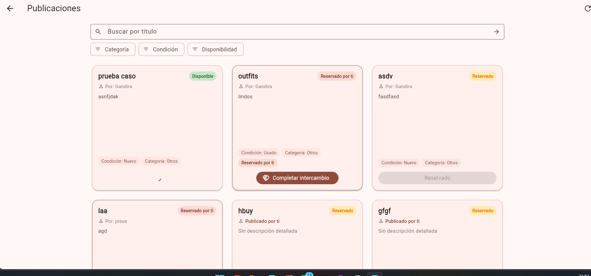 (la tarjeta «prueba caso» muestra el spinner).
- **Antes** (`34f3d53`): `trueque-u/app/lib/pantallas/pantalla_mis_publicaciones.dart:L102-L123` (`_cambiarEstado`), `L165-L205` (`_completar`), `L64-L98` (`_eliminar`) sin estado de progreso · `trueque-u/app/lib/widgets/tarjeta_mi_publicacion.dart:L12-L29` (la tarjeta no recibe `enProgreso`).
  - Captura: 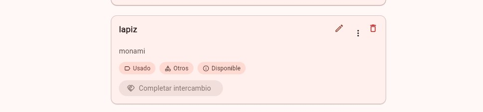
- **Después** (`HEAD`): `trueque-u/app/lib/pantallas/pantalla_mis_publicaciones.dart:L30-L30`, `L88-L102`, `L108-L139`, `L189-L208`, `L310-L310` · `trueque-u/app/lib/widgets/tarjeta_mi_publicacion.dart:L40-L40`, `L69-L72`, `L98-L98`, `L105-L105`, `L146-L146`.
  - Captura: 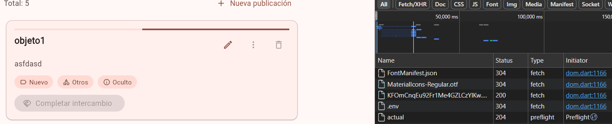
- **Diff:**

```diff
diff --git a/trueque-u/app/lib/pantallas/pantalla_mis_publicaciones.dart b/trueque-u/app/lib/pantallas/pantalla_mis_publicaciones.dart
--- a/trueque-u/app/lib/pantallas/pantalla_mis_publicaciones.dart
+++ b/trueque-u/app/lib/pantallas/pantalla_mis_publicaciones.dart
@@ -28,2 +28,5 @@ class _PantallaMisPublicacionesState extends State<PantallaMisPublicaciones> {
 
+  // Ids con una acción en curso: se muestra progreso y se bloquean sus botones
+  final Set<int> _accionesEnProgreso = {};
+
   @override
@@ -84,2 +87,3 @@ class _PantallaMisPublicacionesState extends State<PantallaMisPublicaciones> {
 
+    setState(() => _accionesEnProgreso.add(id));
     try {
@@ -96,2 +100,4 @@ class _PantallaMisPublicacionesState extends State<PantallaMisPublicaciones> {
       );
+    } finally {
+      if (mounted) setState(() => _accionesEnProgreso.remove(id));
     }
@@ -102,2 +108,3 @@ class _PantallaMisPublicacionesState extends State<PantallaMisPublicaciones> {
   Future<void> _cambiarEstado(int id, String nuevoEstado) async {
+    setState(() => _accionesEnProgreso.add(id));
     try {
@@ -121,2 +128,4 @@ class _PantallaMisPublicacionesState extends State<PantallaMisPublicaciones> {
       );
+    } finally {
+      if (mounted) setState(() => _accionesEnProgreso.remove(id));
     }
@@ -170,2 +179,3 @@ class _PantallaMisPublicacionesState extends State<PantallaMisPublicaciones> {
 
+    setState(() => _accionesEnProgreso.add(id));
     try {
@@ -187,2 +197,4 @@ class _PantallaMisPublicacionesState extends State<PantallaMisPublicaciones> {
       );
+    } finally {
+      if (mounted) setState(() => _accionesEnProgreso.remove(id));
     }
@@ -288,2 +300,3 @@ class _PantallaMisPublicacionesState extends State<PantallaMisPublicaciones> {
                 telefonoReserva: telefonoReserva,
+                enProgreso: _accionesEnProgreso.contains(idPub),
                 alCompletar: () => _completar(idPub, tituloPub, estaReservada),
diff --git a/trueque-u/app/lib/widgets/tarjeta_mi_publicacion.dart b/trueque-u/app/lib/widgets/tarjeta_mi_publicacion.dart
--- a/trueque-u/app/lib/widgets/tarjeta_mi_publicacion.dart
+++ b/trueque-u/app/lib/widgets/tarjeta_mi_publicacion.dart
@@ -22,2 +22,3 @@ class TarjetaMiPublicacion extends StatelessWidget {
     this.telefonoReserva,
+    required this.enProgreso,
     required this.alCompletar,
@@ -38,2 +39,3 @@ class TarjetaMiPublicacion extends StatelessWidget {
   final String? telefonoReserva;
+  final bool enProgreso; // hay una acción en curso con esta publicación
   final VoidCallback alCompletar;
@@ -65,2 +67,7 @@ class TarjetaMiPublicacion extends StatelessWidget {
           children: [
+            // Indicador de progreso mientras el servidor responde
+            if (enProgreso) ...[
+              const LinearProgressIndicator(minHeight: 3),
+              const SizedBox(height: 8),
+            ],
             // Encabezado: Título y menú de opciones (editar / cambiar estado / eliminar)
@@ -92,3 +99,3 @@ class TarjetaMiPublicacion extends StatelessWidget {
                   constraints: const BoxConstraints(),
-                  onPressed: alEditar,
+                  onPressed: enProgreso ? null : alEditar,
                 ),
@@ -99,2 +106,3 @@ class TarjetaMiPublicacion extends StatelessWidget {
                   tooltip: 'Cambiar modo / estado',
+                  enabled: !enProgreso,
                   onSelected: alCambiarEstado,
@@ -137,3 +145,3 @@ class TarjetaMiPublicacion extends StatelessWidget {
                   tooltip: 'Eliminar definitivamente',
-                  onPressed: alEliminar,
+                  onPressed: enProgreso ? null : alEliminar,
                   padding: EdgeInsets.zero,
@@ -246,3 +254,3 @@ class TarjetaMiPublicacion extends StatelessWidget {
                   ),
-                  onPressed: alCompletar,
+                  onPressed: enProgreso ? null : alCompletar,
                 ),
```

### H2 — Relación entre el sistema y el mundo real
- **Estado:** Corregida · **Severidad:** 1 (Cosmético) · **Sub-issue:** #11 · **Commit:** `4ab1b0e`
- **Pantalla / flujo:** Feed (tarjeta de mi propia publicación) y Mis publicaciones (menú de estado).
- **Explicación.** El lenguaje general es claro y en español («Reservar», «Completar intercambio», «Intercambios completados»), pero había tres textos que no hablan como el usuario: la abreviatura «pubs», el tooltip «Cambiar modo / estado» y un aviso que imprimía el valor interno (`"no disponible"`, `"oculto"`).
- **Antes** (`34f3d53`): `trueque-u/app/lib/widgets/tarjeta_feed.dart:L280-L280` · `trueque-u/app/lib/widgets/tarjeta_mi_publicacion.dart:L99-L99` · `trueque-u/app/lib/pantallas/pantalla_mis_publicaciones.dart:L109-L109`.
  - Capturas: 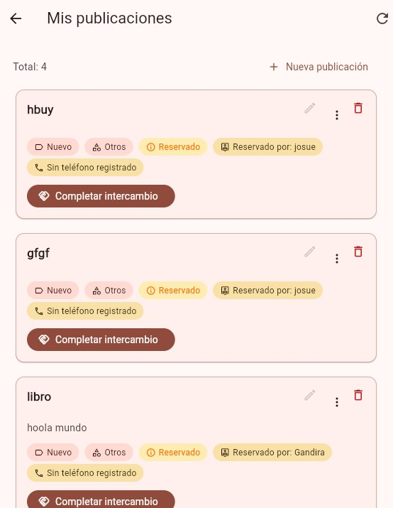 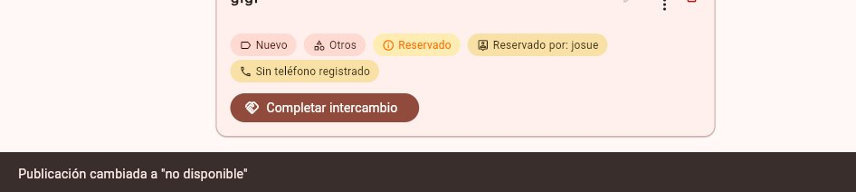
- **Después** (`HEAD`): `trueque-u/app/lib/widgets/tarjeta_feed.dart:L303-L303` · `trueque-u/app/lib/widgets/tarjeta_mi_publicacion.dart:L104-L104` · `trueque-u/app/lib/pantallas/pantalla_mis_publicaciones.dart:L115-L125`.
  - Capturas: 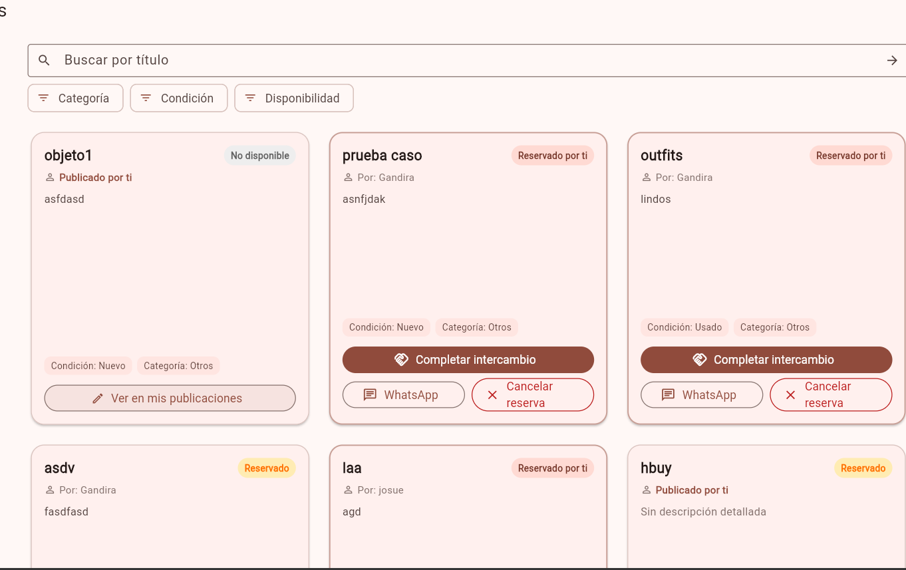 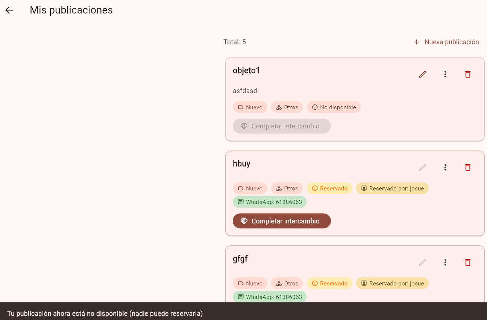
- **Diff:**

```diff
diff --git a/trueque-u/app/lib/pantallas/pantalla_mis_publicaciones.dart b/trueque-u/app/lib/pantallas/pantalla_mis_publicaciones.dart
--- a/trueque-u/app/lib/pantallas/pantalla_mis_publicaciones.dart
+++ b/trueque-u/app/lib/pantallas/pantalla_mis_publicaciones.dart
@@ -114,4 +114,13 @@ class _PantallaMisPublicacionesState extends State<PantallaMisPublicaciones> {
       if (!mounted) return;
+      const nombres = {
+        'disponible': 'disponible',
+        'oculto': 'oculta (solo tú la ves)',
+        'no disponible': 'no disponible (nadie puede reservarla)',
+      };
       ScaffoldMessenger.of(context).showSnackBar(
-        SnackBar(content: Text('Publicación cambiada a "$nuevoEstado"')),
+        SnackBar(
+          content: Text(
+            'Tu publicación ahora está ${nombres[nuevoEstado] ?? nuevoEstado}',
+          ),
+        ),
       );
diff --git a/trueque-u/app/lib/widgets/tarjeta_feed.dart b/trueque-u/app/lib/widgets/tarjeta_feed.dart
--- a/trueque-u/app/lib/widgets/tarjeta_feed.dart
+++ b/trueque-u/app/lib/widgets/tarjeta_feed.dart
@@ -310,3 +310,3 @@ class TarjetaFeed extends StatelessWidget {
         icon: const Icon(Icons.edit_outlined, size: 16),
-        label: const Text('Tu publicación (Ver en mis pubs)'),
+        label: const Text('Ver en mis publicaciones'),
         onPressed: () => context.go('/mis-publicaciones'),
diff --git a/trueque-u/app/lib/widgets/tarjeta_mi_publicacion.dart b/trueque-u/app/lib/widgets/tarjeta_mi_publicacion.dart
--- a/trueque-u/app/lib/widgets/tarjeta_mi_publicacion.dart
+++ b/trueque-u/app/lib/widgets/tarjeta_mi_publicacion.dart
@@ -105,3 +105,3 @@ class TarjetaMiPublicacion extends StatelessWidget {
                   icon: const Icon(Icons.more_vert, size: 20),
-                  tooltip: 'Cambiar modo / estado',
+                  tooltip: 'Cambiar estado de la publicación',
                   enabled: !enProgreso,
```

### H3 — Control y libertad del usuario
- **Estado:** Corregida · **Severidad:** 4 (Crítico) · **Sub-issue:** #8 · **Commit:** `1fd8aae`
- **Pantalla / flujo:** Feed → publicación «Reservada por ti».
- **Explicación.** Quien reservaba por error quedaba atrapado: el botón «Descartar reserva» estaba comentado y solo quedaba «Completar intercambio». El backend ya soportaba liberar la reserva, así que el usuario no tenía «salida de emergencia» en un paso esencial del flujo. Ahora existe «Cancelar reserva» con confirmación y botones inequívocos («Sí, cancelar reserva» / «Mantener reserva»).
- **Antes** (`34f3d53`): `trueque-u/app/lib/widgets/tarjeta_feed.dart:L232-L255` (botón comentado en `L243-L252`) · `trueque-u/app/lib/widgets/tarjeta_mi_publicacion.dart:L227-L236` · soporte existente en backend: `trueque-u/backend/src/controllers/reservas.controlador.js:L80-L143`.
  - Captura: 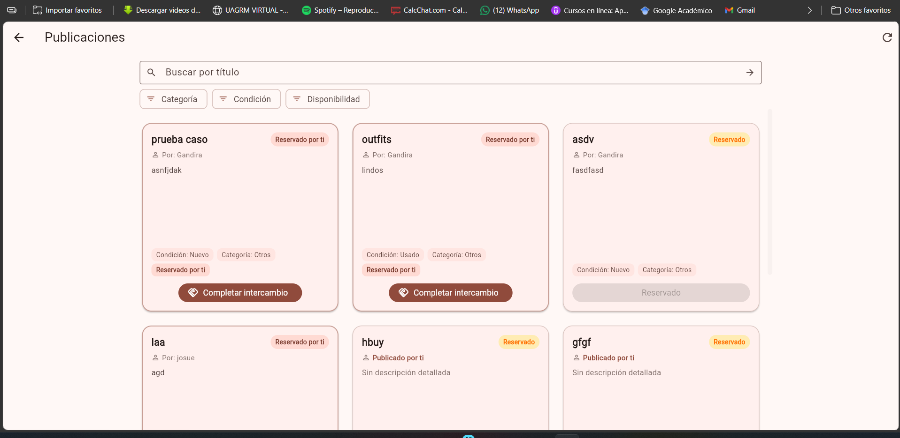
- **Después** (`HEAD`): `trueque-u/app/lib/widgets/tarjeta_feed.dart:L230-L280` · `trueque-u/app/lib/pantallas/pantalla_feed_publicaciones.dart:L193-L206` · `trueque-u/app/lib/widgets/dialogo_confirmacion.dart:L4-L20`.
  - Capturas: 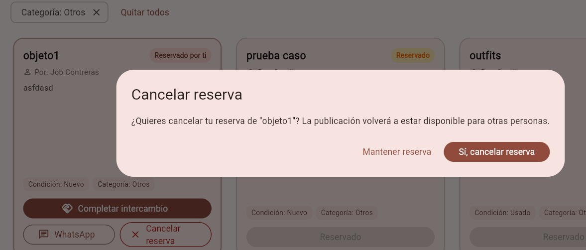 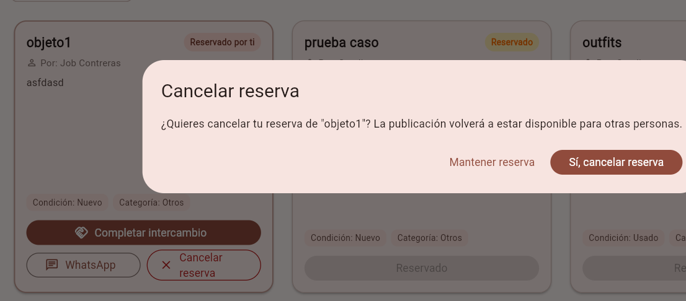
- **Diff:**

```diff
diff --git a/trueque-u/app/lib/pantallas/pantalla_feed_publicaciones.dart b/trueque-u/app/lib/pantallas/pantalla_feed_publicaciones.dart
--- a/trueque-u/app/lib/pantallas/pantalla_feed_publicaciones.dart
+++ b/trueque-u/app/lib/pantallas/pantalla_feed_publicaciones.dart
@@ -184,5 +184,17 @@ class _PantallaFeedPublicacionesState extends State<PantallaFeedPublicaciones> {
   /// Envía la petición PUT /api/publicaciones/:id/disponible para liberar la publicación
-  Future<void> _descartarReserva(int idPublicacion) async {
+  Future<void> _descartarReserva(int idPublicacion, String titulo) async {
     final auth = context.read<ControladorAutenticacion>();
 
+    // H3 (control y libertad): quien reservó puede cancelar, pero se le pide confirmar
+    final acepta = await confirmarAccion(
+      context,
+      titulo: 'Cancelar reserva',
+      mensaje:
+          '¿Quieres cancelar tu reserva de "$titulo"? La publicación '
+          'volverá a estar disponible para otras personas.',
+      textoBoton: 'Sí, cancelar reserva',
+      textoCancelar: 'Mantener reserva',
+    );
+    if (!acepta || !mounted) return;
+
     setState(() => _accionesEnProgreso.add(idPublicacion));
@@ -309,3 +321,3 @@ class _PantallaFeedPublicacionesState extends State<PantallaFeedPublicaciones> {
                   // Relación de aspecto adaptada para acomodar título, descripción y botones
-                  mainAxisExtent: 330,
+                  mainAxisExtent: 360,
                 ),
@@ -348,3 +360,3 @@ class _PantallaFeedPublicacionesState extends State<PantallaFeedPublicaciones> {
                     alReservar: () => _reservar(id, tituloPub),
-                    alDescartar: () => _descartarReserva(id),
+                    alDescartar: () => _descartarReserva(id, tituloPub),
                     alCompletar: () => _completar(id, tituloPub),
diff --git a/trueque-u/app/lib/widgets/dialogo_confirmacion.dart b/trueque-u/app/lib/widgets/dialogo_confirmacion.dart
--- a/trueque-u/app/lib/widgets/dialogo_confirmacion.dart
+++ b/trueque-u/app/lib/widgets/dialogo_confirmacion.dart
@@ -8,2 +8,3 @@ Future<bool> confirmarAccion(
   required String textoBoton,
+  String textoCancelar = 'Cancelar',
 }) async {
@@ -17,3 +18,3 @@ Future<bool> confirmarAccion(
           onPressed: () => Navigator.of(ctx).pop(false),
-          child: const Text('Cancelar'),
+          child: Text(textoCancelar),
         ),
diff --git a/trueque-u/app/lib/widgets/tarjeta_feed.dart b/trueque-u/app/lib/widgets/tarjeta_feed.dart
--- a/trueque-u/app/lib/widgets/tarjeta_feed.dart
+++ b/trueque-u/app/lib/widgets/tarjeta_feed.dart
@@ -207,3 +207,3 @@ class TarjetaFeed extends StatelessWidget {
   Widget _construirBotonAccion(BuildContext context) {
-    // final colores = Theme.of(context).colorScheme; // se usaba en "Descartar reserva"
+    final colores = Theme.of(context).colorScheme;
 
@@ -231,4 +231,3 @@ class TarjetaFeed extends StatelessWidget {
 
-    // Caso 1: Reservada por el usuario actual -> "Completar intercambio"
-    // (la opción de descartar la reserva está comentada por ahora)
+    // Caso 1: Reservada por el usuario actual -> puede completar o cancelar la reserva
     if (estaReservado && loReserveYo) {
@@ -236,2 +235,3 @@ class TarjetaFeed extends StatelessWidget {
         mainAxisSize: MainAxisSize.min,
+        crossAxisAlignment: CrossAxisAlignment.stretch,
         children: [
@@ -242,12 +242,13 @@ class TarjetaFeed extends StatelessWidget {
           ),
-          // const SizedBox(height: 6),
-          // OutlinedButton.icon(
-          //   icon: const Icon(Icons.close, size: 18),
-          //   label: const Text('Descartar reserva'),
-          //   style: OutlinedButton.styleFrom(
-          //     foregroundColor: colores.error,
-          //     side: BorderSide(color: colores.error),
-          //   ),
-          //   onPressed: alDescartar,
-          // ),
+          const SizedBox(height: 6),
+          // H3: salida de emergencia para quien reservó por error
+          OutlinedButton.icon(
+            icon: const Icon(Icons.close, size: 18),
+            label: const Text('Cancelar reserva'),
+            style: OutlinedButton.styleFrom(
+              foregroundColor: colores.error,
+              side: BorderSide(color: colores.error),
+            ),
+            onPressed: alDescartar,
+          ),
         ],
```

### H4 — Consistencia y estándares
- **Estado:** Corregida · **Severidad:** 2 (Menor) · **Sub-issue:** #12 · **Commit:** `70bd0ee`
- **Pantalla / flujo:** Mis publicaciones → «Completar intercambio» en una publicación sin reserva.
- **Explicación.** El mismo control se comportaba distinto según la pantalla: en el feed se oculta o queda realmente deshabilitado; en Mis publicaciones se pintaba gris pero seguía respondiendo al toque (y mostraba un aviso). Un botón que parece deshabilitado pero está activo rompe el estándar de Material. Ahora se deshabilita de verdad y un tooltip explica cuándo se habilita.
- **Antes** (`34f3d53`): `trueque-u/app/lib/widgets/tarjeta_mi_publicacion.dart:L239-L248` · referencia consistente: `trueque-u/app/lib/widgets/tarjeta_feed.dart:L257-L283`.
  - Captura: 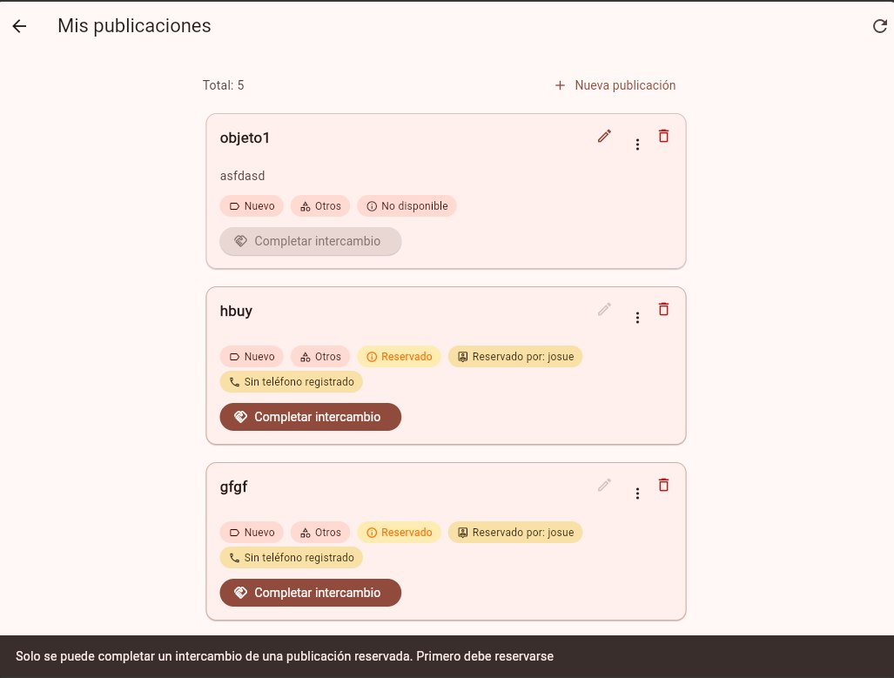
- **Después** (`HEAD`): `trueque-u/app/lib/widgets/tarjeta_mi_publicacion.dart:L245-L258`.
  - Captura: 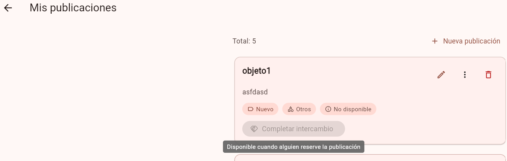
- **Diff:**

```diff
diff --git a/trueque-u/app/lib/widgets/tarjeta_mi_publicacion.dart b/trueque-u/app/lib/widgets/tarjeta_mi_publicacion.dart
--- a/trueque-u/app/lib/widgets/tarjeta_mi_publicacion.dart
+++ b/trueque-u/app/lib/widgets/tarjeta_mi_publicacion.dart
@@ -246,11 +246,15 @@ class TarjetaMiPublicacion extends StatelessWidget {
                 // (si no, al tocarlo se explica el motivo)
-                FilledButton.icon(
-                  icon: const Icon(Icons.handshake_outlined, size: 16),
-                  label: const Text('Completar intercambio'),
-                  style: FilledButton.styleFrom(
-                    visualDensity: VisualDensity.compact,
-                    backgroundColor: estaReservada ? null : colores.surfaceContainerHighest,
-                    foregroundColor: estaReservada ? null : colores.outline,
+                Tooltip(
+                  message: estaReservada
+                      ? 'Completar el intercambio'
+                      : 'Disponible cuando alguien reserve la publicación',
+                  child: FilledButton.icon(
+                    icon: const Icon(Icons.handshake_outlined, size: 16),
+                    label: const Text('Completar intercambio'),
+                    style: FilledButton.styleFrom(
+                      visualDensity: VisualDensity.compact,
+                    ),
+                    // Sin reserva se deshabilita de verdad (igual que en el feed)
+                    onPressed: (estaReservada && !enProgreso) ? alCompletar : null,
                   ),
-                  onPressed: enProgreso ? null : alCompletar,
                 ),
```

### H5 — Prevención de errores
- **Estado:** Corregida (2 hallazgos) · **Sub-issues:** #7 y #13 · **Commits:** `5ab5194`, `abc2471`
- **Pantalla / flujo:** Feed → «Reservar» (#7) · Mis publicaciones → iconos editar / estado / eliminar (#13, Ley de Fitts).
- **Hallazgo #7 — Severidad 3 (Mayor).** «Reservar» enviaba la reserva al instante, sin confirmar (la captura muestra el spinner justo después del toque, sin diálogo). Un toque accidental aparta el objeto de otras personas. Completar el intercambio y eliminar sí pedían confirmación, por lo que el flujo era incoherente.
  - **Antes** (`34f3d53`): `trueque-u/app/lib/pantallas/pantalla_feed_publicaciones.dart:L138-L170` · `trueque-u/app/lib/widgets/tarjeta_feed.dart:L285-L290`.
    Capturas: 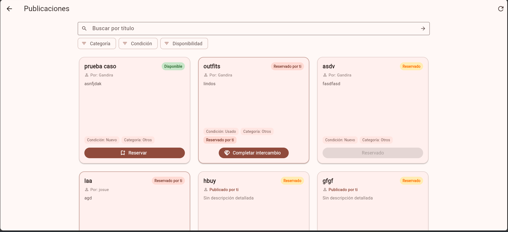 
  - **Después** (`HEAD`): `trueque-u/app/lib/pantallas/pantalla_feed_publicaciones.dart:L142-L156`.
    Captura: 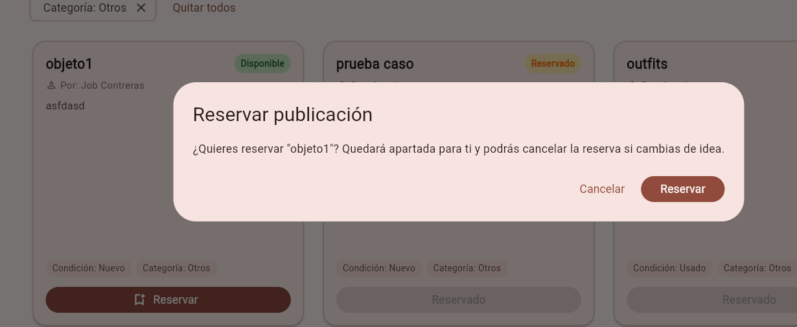
- **Hallazgo #13 — Severidad 2 (Menor), Ley de Fitts.** Los iconos de editar y eliminar tenían `padding: EdgeInsets.zero` y `constraints: BoxConstraints()`: área táctil de ~20 px (mínimo recomendado 48 px) y «Eliminar» pegado a «Editar». Había confirmación como red de seguridad, pero el diseño favorecía el error.
  - **Antes** (`34f3d53`): `trueque-u/app/lib/widgets/tarjeta_mi_publicacion.dart:L80-L94`, `L134-L141`.
    Captura: 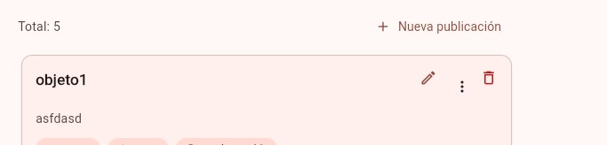
  - **Después** (`HEAD`): `trueque-u/app/lib/widgets/tarjeta_mi_publicacion.dart:L86-L98`, `L140-L147`.
    Captura: 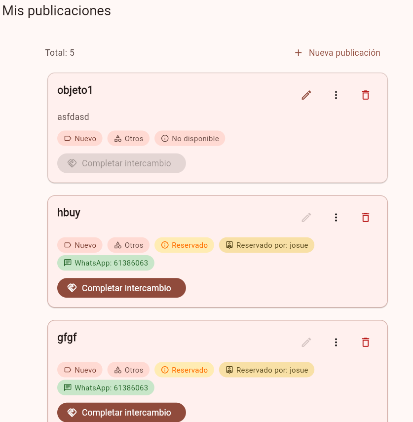
- **Lo que ya cumple en el flujo:** confirmación al completar (`trueque-u/app/lib/pantallas/pantalla_feed_publicaciones.dart:L237-L248`) y al eliminar (`trueque-u/app/lib/pantallas/pantalla_mis_publicaciones.dart:L67-L86`); validación de formularios (`trueque-u/app/lib/utilidades/validadores.dart:L2-L22`); el dueño no ve «Reservar» en su propia publicación (`trueque-u/app/lib/widgets/tarjeta_feed.dart:L299-L306`) y el servidor también lo impide (`trueque-u/backend/src/controllers/reservas.controlador.js:L40-L45`).
- **Diff #7:**

```diff
diff --git a/trueque-u/app/lib/pantallas/pantalla_feed_publicaciones.dart b/trueque-u/app/lib/pantallas/pantalla_feed_publicaciones.dart
--- a/trueque-u/app/lib/pantallas/pantalla_feed_publicaciones.dart
+++ b/trueque-u/app/lib/pantallas/pantalla_feed_publicaciones.dart
@@ -139,3 +139,3 @@ class _PantallaFeedPublicacionesState extends State<PantallaFeedPublicaciones> {
   /// Envía la petición PUT /api/publicaciones/:id/reservado (el servidor usa la sesión)
-  Future<void> _reservar(int idPublicacion) async {
+  Future<void> _reservar(int idPublicacion, String titulo) async {
     final auth = context.read<ControladorAutenticacion>();
@@ -144,2 +144,13 @@ class _PantallaFeedPublicacionesState extends State<PantallaFeedPublicaciones> {
 
+    // H5 (prevención de errores): se pide confirmación antes de apartar el objeto
+    final acepta = await confirmarAccion(
+      context,
+      titulo: 'Reservar publicación',
+      mensaje:
+          '¿Quieres reservar "$titulo"? Quedará apartada para ti y '
+          'podrás cancelar la reserva si cambias de idea.',
+      textoBoton: 'Reservar',
+    );
+    if (!acepta || !mounted) return;
+
     setState(() => _accionesEnProgreso.add(idPublicacion));
@@ -336,3 +347,3 @@ class _PantallaFeedPublicacionesState extends State<PantallaFeedPublicaciones> {
                     enProgreso: enProgreso,
-                    alReservar: () => _reservar(id),
+                    alReservar: () => _reservar(id, tituloPub),
                     alDescartar: () => _descartarReserva(id),
```

- **Diff #13:**

```diff
diff --git a/trueque-u/app/lib/widgets/tarjeta_mi_publicacion.dart b/trueque-u/app/lib/widgets/tarjeta_mi_publicacion.dart
--- a/trueque-u/app/lib/widgets/tarjeta_mi_publicacion.dart
+++ b/trueque-u/app/lib/widgets/tarjeta_mi_publicacion.dart
@@ -97,4 +97,2 @@ class TarjetaMiPublicacion extends StatelessWidget {
                       : 'Editar información',
-                  padding: EdgeInsets.zero,
-                  constraints: const BoxConstraints(),
                   onPressed: enProgreso ? null : alEditar,
@@ -141,2 +139,4 @@ class TarjetaMiPublicacion extends StatelessWidget {
                 ),
+                // Acción destructiva separada de las demás, con área táctil estándar (Ley de Fitts)
+                const SizedBox(width: 8),
                 IconButton(
@@ -146,4 +146,2 @@ class TarjetaMiPublicacion extends StatelessWidget {
                   onPressed: enProgreso ? null : alEliminar,
-                  padding: EdgeInsets.zero,
-                  constraints: const BoxConstraints(),
                 ),
```

### H6 — Reconocer antes que recordar
- **Estado:** **Cumple** · **Severidad:** 0 (no es un problema)
- **Pantalla / flujo:** Feed (filtros y tarjetas) → diálogo de «Completar intercambio».
- **Cómo y dónde se comprobó.**
  - Los filtros activos quedan visibles como chips con su «X» y un «Quitar todos»; el usuario no tiene que recordar qué filtró: `trueque-u/app/lib/widgets/filtros_feed.dart:L91-L126`.
  - Cada tarjeta muestra autor, estado, condición y categoría sin abrir otra pantalla: `trueque-u/app/lib/widgets/tarjeta_feed.dart:L73-L111`.
  - El diálogo de completar repite el **título del objeto** en el mensaje, así no hay que recordar qué se está confirmando: `trueque-u/app/lib/pantallas/pantalla_feed_publicaciones.dart:L240-L248`.
  - Los estados vacíos explican qué hacer y ofrecen la acción siguiente: `trueque-u/app/lib/widgets/mensaje_vacio.dart:L5-L53`.
  - Capturas: 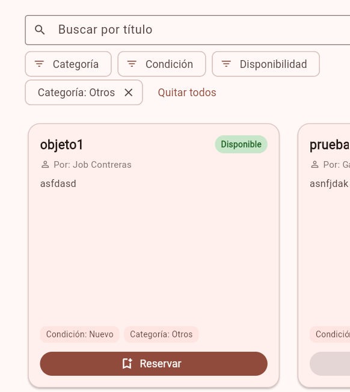 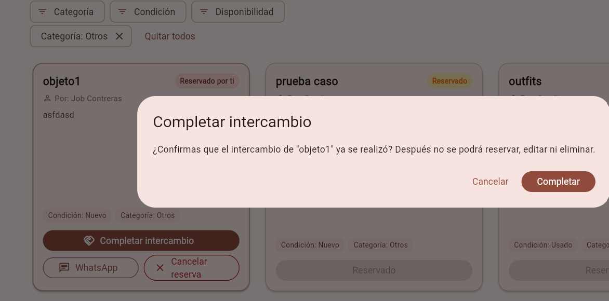

### H7 — Flexibilidad y eficiencia de uso
- **Estado:** Corregida · **Severidad:** 4 (Crítico) · **Sub-issue:** #9 · **Commit:** `59a672f`
- **Pantalla / flujo:** Feed → publicación reservada por mí → coordinar la entrega.
- **Explicación.** El dueño tenía un acceso directo a WhatsApp de quien reservó, pero quien reserva no veía ningún dato ni botón para contactar al dueño: no podía coordinar la entrega, que es el objetivo central de una app de trueques. Ahora el servidor envía el teléfono del autor **solo** a quien reservó (con pruebas automáticas) y la tarjeta ofrece un botón «WhatsApp» (un toque, mensaje prellenado). Si el dueño no registró teléfono, se avisa. Al reservar, el aviso indica el siguiente paso. (Ley de Fitts: el botón es grande y está junto a «Completar intercambio».)
- **Antes** (`34f3d53`): `trueque-u/backend/src/controllers/publicaciones.controlador.js:L14-L33` y `L92-L103` (el teléfono solo salía en «Mis publicaciones») · `trueque-u/app/lib/widgets/tarjeta_feed.dart:L168-L190`, `L232-L255` · referencia del dueño: `trueque-u/app/lib/widgets/tarjeta_mi_publicacion.dart:L193-L209`.
  - Captura: 
- **Después** (`HEAD`): `trueque-u/backend/src/controllers/publicaciones.controlador.js:L35-L44`, `L99-L99`, `L113-L120` · `trueque-u/backend/src/controllers/publicaciones.controlador.test.js:L130-L163` · `trueque-u/app/lib/widgets/tarjeta_feed.dart:L243-L277` · `trueque-u/app/lib/pantallas/pantalla_feed_publicaciones.dart:L346-L346`, `L370-L376`, `L163-L172` · `trueque-u/app/lib/utilidades/whatsapp.dart:L1-L28`.
  - Capturas: 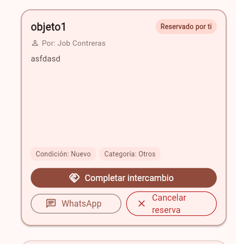 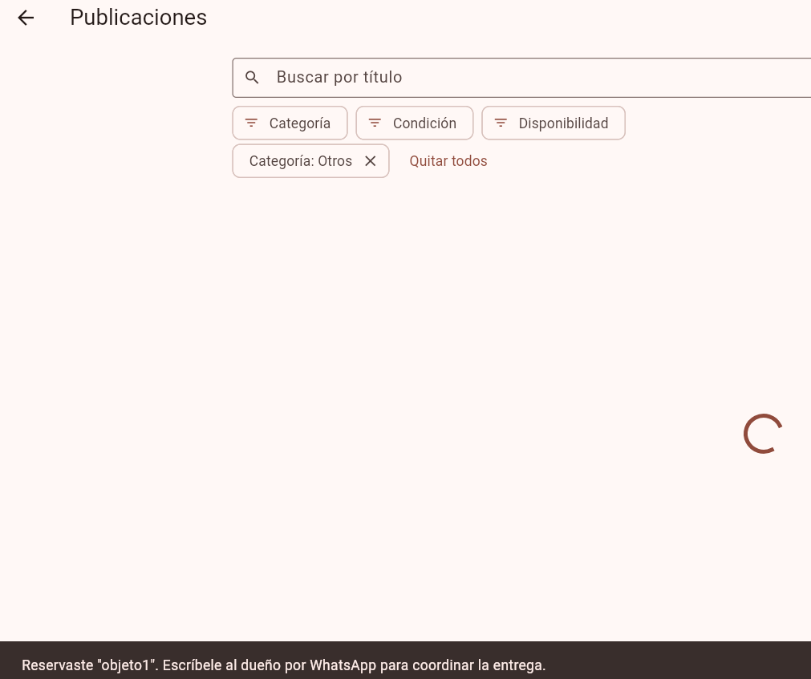
- **Diff:**

```diff
diff --git a/trueque-u/app/lib/pantallas/pantalla_feed_publicaciones.dart b/trueque-u/app/lib/pantallas/pantalla_feed_publicaciones.dart
--- a/trueque-u/app/lib/pantallas/pantalla_feed_publicaciones.dart
+++ b/trueque-u/app/lib/pantallas/pantalla_feed_publicaciones.dart
@@ -6,2 +6,3 @@ import '../estado/controlador_autenticacion.dart';
 import '../servicios/cliente_api.dart';
+import '../utilidades/whatsapp.dart';
 import '../widgets/dialogo_confirmacion.dart';
@@ -160,4 +161,10 @@ class _PantallaFeedPublicacionesState extends State<PantallaFeedPublicaciones> {
       if (!mounted) return;
+      // H1/H7: se dice qué pasó y cuál es el siguiente paso
       ScaffoldMessenger.of(context).showSnackBar(
-        const SnackBar(content: Text('¡Publicación reservada exitosamente!')),
+        SnackBar(
+          duration: const Duration(seconds: 6),
+          content: Text(
+            'Reservaste "$titulo". Escríbele al dueño por WhatsApp para coordinar la entrega.',
+          ),
+        ),
       );
@@ -336,2 +343,4 @@ class _PantallaFeedPublicacionesState extends State<PantallaFeedPublicaciones> {
                   final nombreReserva = usuarioReserva?['nombre'] as String?;
+                  // El servidor manda el teléfono del dueño solo a quien reservó
+                  final telefonoAutor = autor?['telefono'] as String?;
 
@@ -359,2 +368,9 @@ class _PantallaFeedPublicacionesState extends State<PantallaFeedPublicaciones> {
                     enProgreso: enProgreso,
+                    telefonoDueno: telefonoAutor,
+                    alContactar: () => abrirWhatsapp(
+                      context,
+                      telefonoAutor ?? '',
+                      mensaje:
+                          'Hola $nombreAutor, reservé "$tituloPub" en Trueque U. ¿Coordinamos la entrega?',
+                    ),
                     alReservar: () => _reservar(id, tituloPub),
diff --git a/trueque-u/app/lib/pantallas/pantalla_mis_publicaciones.dart b/trueque-u/app/lib/pantallas/pantalla_mis_publicaciones.dart
--- a/trueque-u/app/lib/pantallas/pantalla_mis_publicaciones.dart
+++ b/trueque-u/app/lib/pantallas/pantalla_mis_publicaciones.dart
@@ -3,3 +3,2 @@ import 'package:go_router/go_router.dart';
 import 'package:provider/provider.dart';
-import 'package:url_launcher/url_launcher.dart';
 
@@ -7,2 +6,3 @@ import '../estado/controlador_autenticacion.dart';
 import '../servicios/cliente_api.dart';
+import '../utilidades/whatsapp.dart';
 import '../widgets/dialogo_confirmacion.dart';
@@ -146,18 +146,2 @@ class _PantallaMisPublicacionesState extends State<PantallaMisPublicaciones> {
 
-  /// Abre el chat de WhatsApp con el teléfono de quien reservó (Bolivia: +591).
-  Future<void> _abrirWhatsapp(String telefono) async {
-    final enlace = Uri.parse('https://wa.me/591$telefono');
-    bool abierto = false;
-    try {
-      abierto = await launchUrl(enlace, mode: LaunchMode.externalApplication);
-    } catch (_) {
-      abierto = false;
-    }
-    if (!abierto && mounted) {
-      ScaffoldMessenger.of(context).showSnackBar(
-        const SnackBar(content: Text('No se pudo abrir WhatsApp')),
-      );
-    }
-  }
-
   /// Completa el intercambio de una publicación reservada (pide confirmación).
@@ -305,3 +289,3 @@ class _PantallaMisPublicacionesState extends State<PantallaMisPublicaciones> {
                 alCompletar: () => _completar(idPub, tituloPub, estaReservada),
-                alAbrirWhatsapp: () => _abrirWhatsapp(telefonoReserva ?? ''),
+                alAbrirWhatsapp: () => abrirWhatsapp(context, telefonoReserva ?? ''),
                 alEditar: () => _editar(
diff --git a/trueque-u/app/lib/utilidades/whatsapp.dart b/trueque-u/app/lib/utilidades/whatsapp.dart
new file mode 100644
--- /dev/null
+++ b/trueque-u/app/lib/utilidades/whatsapp.dart
@@ -0,0 +1,28 @@
+import 'package:flutter/material.dart';
+import 'package:url_launcher/url_launcher.dart';
+
+/// Abre el chat de WhatsApp con un teléfono de Bolivia (+591).
+/// Si hay un [mensaje], el chat se abre con ese texto ya escrito.
+Future<void> abrirWhatsapp(
+  BuildContext context,
+  String telefono, {
+  String? mensaje,
+}) async {
+  final texto = mensaje == null ? '' : '?text=${Uri.encodeComponent(mensaje)}';
+  final enlace = Uri.parse('https://wa.me/591$telefono$texto');
+  bool abierto = false;
+  try {
+    abierto = await launchUrl(enlace, mode: LaunchMode.externalApplication);
+  } catch (_) {
+    abierto = false;
+  }
+  if (!abierto && context.mounted) {
+    ScaffoldMessenger.of(context).showSnackBar(
+      const SnackBar(
+        content: Text(
+          'No se pudo abrir WhatsApp. Revisa que esté instalado o inténtalo desde el navegador.',
+        ),
+      ),
+    );
+  }
+}
diff --git a/trueque-u/app/lib/widgets/tarjeta_feed.dart b/trueque-u/app/lib/widgets/tarjeta_feed.dart
--- a/trueque-u/app/lib/widgets/tarjeta_feed.dart
+++ b/trueque-u/app/lib/widgets/tarjeta_feed.dart
@@ -22,2 +22,3 @@ class TarjetaFeed extends StatelessWidget {
     this.nombreReserva,
+    this.telefonoDueno,
     required this.estaReservado,
@@ -26,2 +27,3 @@ class TarjetaFeed extends StatelessWidget {
     required this.enProgreso,
+    required this.alContactar,
     required this.alReservar,
@@ -39,2 +41,3 @@ class TarjetaFeed extends StatelessWidget {
   final String? nombreReserva;
+  final String? telefonoDueno; // solo llega si yo reservé
   final bool estaReservado;
@@ -43,2 +46,3 @@ class TarjetaFeed extends StatelessWidget {
   final bool enProgreso;
+  final VoidCallback alContactar;
   final VoidCallback alReservar;
@@ -233,2 +237,3 @@ class TarjetaFeed extends StatelessWidget {
     if (estaReservado && loReserveYo) {
+      final tieneTelefono = telefonoDueno != null && telefonoDueno!.isNotEmpty;
       return Column(
@@ -243,12 +248,37 @@ class TarjetaFeed extends StatelessWidget {
           const SizedBox(height: 6),
-          // H3: salida de emergencia para quien reservó por error
-          OutlinedButton.icon(
-            icon: const Icon(Icons.close, size: 18),
-            label: const Text('Cancelar reserva'),
-            style: OutlinedButton.styleFrom(
-              foregroundColor: colores.error,
-              side: BorderSide(color: colores.error),
-            ),
-            onPressed: alDescartar,
+          Row(
+            children: [
+              // H7: quien reservó escribe al dueño con un toque para coordinar la entrega
+              if (tieneTelefono) ...[
+                Expanded(
+                  child: OutlinedButton.icon(
+                    icon: const Icon(Icons.chat_outlined, size: 18),
+                    label: const Text('WhatsApp'),
+                    onPressed: alContactar,
+                  ),
+                ),
+                const SizedBox(width: 8),
+              ],
+              // H3: salida de emergencia para quien reservó por error
+              Expanded(
+                child: OutlinedButton.icon(
+                  icon: const Icon(Icons.close, size: 18),
+                  label: const Text('Cancelar reserva'),
+                  style: OutlinedButton.styleFrom(
+                    foregroundColor: colores.error,
+                    side: BorderSide(color: colores.error),
+                  ),
+                  onPressed: alDescartar,
+                ),
+              ),
+            ],
           ),
+          if (!tieneTelefono) ...[
+            const SizedBox(height: 4),
+            Text(
+              'El dueño no registró teléfono',
+              textAlign: TextAlign.center,
+              style: TextStyle(fontSize: 11, color: colores.outline),
+            ),
+          ],
         ],
diff --git a/trueque-u/backend/src/controllers/publicaciones.controlador.js b/trueque-u/backend/src/controllers/publicaciones.controlador.js
--- a/trueque-u/backend/src/controllers/publicaciones.controlador.js
+++ b/trueque-u/backend/src/controllers/publicaciones.controlador.js
@@ -34,2 +34,13 @@ const INCLUIR_USUARIOS_DUENO = [
 
+// Catálogo general: el autor trae su teléfono para que quien reserve pueda
+// contactarlo (H7). El teléfono se quita abajo para todos los demás.
+const INCLUIR_USUARIOS_CATALOGO = [
+  {
+    model: models.usuarios,
+    as: "autor",
+    attributes: ["id", "nombre", "telefono"],
+  },
+  { model: models.usuarios, as: "usuario_reserva", attributes: ["id", "nombre"] },
+];
+
 // GET /api/publicaciones
@@ -87,3 +98,3 @@ const getPublicaciones = async (req, res) => {
       where: donde,
-      include: INCLUIR_USUARIOS,
+      include: INCLUIR_USUARIOS_CATALOGO,
       order: [["id", "DESC"]], // las más nuevas primero
@@ -101,2 +112,9 @@ const getPublicaciones = async (req, res) => {
       }
+      // El teléfono del dueño solo lo recibe quien reservó (mientras esté reservada)
+      const puedeVerTelefono =
+        esQuienReservo && datos.estado_publicacion === "reservado";
+      if (datos.autor && !puedeVerTelefono) {
+        datos.autor = { ...datos.autor };
+        delete datos.autor.telefono;
+      }
       return datos;
diff --git a/trueque-u/backend/src/controllers/publicaciones.controlador.test.js b/trueque-u/backend/src/controllers/publicaciones.controlador.test.js
--- a/trueque-u/backend/src/controllers/publicaciones.controlador.test.js
+++ b/trueque-u/backend/src/controllers/publicaciones.controlador.test.js
@@ -128 +128,36 @@ describe("Buscar y filtrar publicaciones", () => {
 });
+
+describe("Teléfono del dueño en el catálogo (H7)", () => {
+  beforeEach(() => {
+    models.publicaciones.findAll.mockReset();
+  });
+
+  // Publicación del usuario 1, reservada por el usuario 2
+  const filaReservada = () =>
+    crearFila({
+      id: 7,
+      id_usuario: 1,
+      id_usuario_reserva: 2,
+      estado_publicacion: "reservado",
+      autor: { id: 1, nombre: "Ana", telefono: "70000000" },
+      usuario_reserva: { id: 2, nombre: "Beto" },
+    });
+
+  async function pedirComo(idUsuario) {
+    models.publicaciones.findAll.mockResolvedValue([filaReservada()]);
+    const res = crearRespuesta();
+    await getPublicaciones({ usuario: { id: idUsuario }, query: {} }, res);
+    return res.json.mock.calls[0][0][0];
+  }
+
+  test("quien reservó recibe el teléfono del dueño", async () => {
+    const pub = await pedirComo(2);
+    expect(pub.autor.telefono).toBe("70000000");
+  });
+
+  test("otra persona no recibe el teléfono del dueño", async () => {
+    const pub = await pedirComo(3);
+    expect(pub.autor.telefono).toBeUndefined();
+    expect(pub.autor.nombre).toBe("Ana");
+  });
+});
```

### H8 — Diseño estético y minimalista
- **Estado:** Corregida · **Severidad:** 1 (Cosmético) · **Sub-issue:** #14 · **Commit:** `8574907`
- **Pantalla / flujo:** Feed → tarjeta de una publicación reservada.
- **Explicación.** La tarjeta repetía hasta tres veces que estaba reservada (chip superior, etiqueta inferior y texto del botón: «Reservado por ti» ×2 o «Reservado (nombre)»). Esa redundancia compite con la acción principal. Ahora el chip superior es el único indicador de «Reservado por ti», la etiqueta solo aparece con el nombre de otra persona y el botón dice «Reservado».
- **Antes** (`34f3d53`): `trueque-u/app/lib/widgets/tarjeta_feed.dart:L84-L87`, `L168-L190`, `L266-L274`.
  - Captura:  (tarjeta «outfits»: chip «Reservado por ti» y etiqueta «Reservado por ti»).
- **Después** (`HEAD`): `trueque-u/app/lib/widgets/tarjeta_feed.dart:L171-L186`, `L291-L296`.
  - Captura: 
- **Diff:**

```diff
diff --git a/trueque-u/app/lib/widgets/tarjeta_feed.dart b/trueque-u/app/lib/widgets/tarjeta_feed.dart
--- a/trueque-u/app/lib/widgets/tarjeta_feed.dart
+++ b/trueque-u/app/lib/widgets/tarjeta_feed.dart
@@ -170,4 +170,4 @@ class TarjetaFeed extends StatelessWidget {
                 ),
-                // Muestra qué usuario reservó el objeto si está en estado reservado
-                if (estaReservado && nombreReserva != null)
+                // Quién reservó: solo si fue otra persona (si fui yo, ya lo dice el chip superior)
+                if (estaReservado && !loReserveYo && nombreReserva != null)
                   Container(
@@ -176,5 +176,3 @@ class TarjetaFeed extends StatelessWidget {
                     decoration: BoxDecoration(
-                      color: loReserveYo
-                          ? colores.primaryContainer
-                          : colores.tertiaryContainer,
+                      color: colores.tertiaryContainer,
                       borderRadius: BorderRadius.circular(8),
@@ -182,5 +180,3 @@ class TarjetaFeed extends StatelessWidget {
                     child: Text(
-                      loReserveYo
-                          ? 'Reservado por ti'
-                          : 'Reservado por: $nombreReserva',
+                      'Reservado por: $nombreReserva',
                       style: TextStyle(
@@ -188,5 +184,3 @@ class TarjetaFeed extends StatelessWidget {
                         fontWeight: FontWeight.w600,
-                        color: loReserveYo
-                            ? colores.onPrimaryContainer
-                            : colores.onTertiaryContainer,
+                        color: colores.onTertiaryContainer,
                       ),
@@ -298,7 +292,5 @@ class TarjetaFeed extends StatelessWidget {
     if (estaReservado) {
-      return FilledButton.tonal(
+      return const FilledButton.tonal(
         onPressed: null,
-        child: Text(
-          nombreReserva != null ? 'Reservado ($nombreReserva)' : 'Reservado',
-        ),
+        child: Text('Reservado'),
       );
```

- **Observación (no corregida, severidad 1):** el perfil muestra 6 acciones al mismo nivel (`trueque-u/app/lib/pantallas/pantalla_perfil.dart:L27-L56`). Por la Ley de Hick conviene agruparlas en el futuro; no bloquea ninguna tarea del flujo evaluado.

### H9 — Reconocer, diagnosticar y recuperarse de errores
- **Estado:** Corregida · **Severidad:** 2 (Menor) · **Sub-issue:** #15 · **Commit:** `2b19740`
- **Pantalla / flujo:** cualquier pantalla que llama a la API (feed, reservar, mis publicaciones, intercambios).
- **Explicación.** Los mensajes del servidor ya vienen en español y con la causa (por ejemplo «La publicación ya se encuentra reservada»), y las pantallas con error ofrecen «Reintentar». Pero los errores genéricos salían como «Error 409: …» y la falta de conexión preguntaba «¿Está encendido el backend?»: código y jerga que el usuario no entiende, sin decirle qué hacer. Ahora el código queda solo en el registro de depuración y el texto explica causa y salida.
- **Antes** (`34f3d53`): `trueque-u/app/lib/servicios/cliente_api.dart:L67-L69`, `L85-L89`, `L102-L108`.
  - Captura: 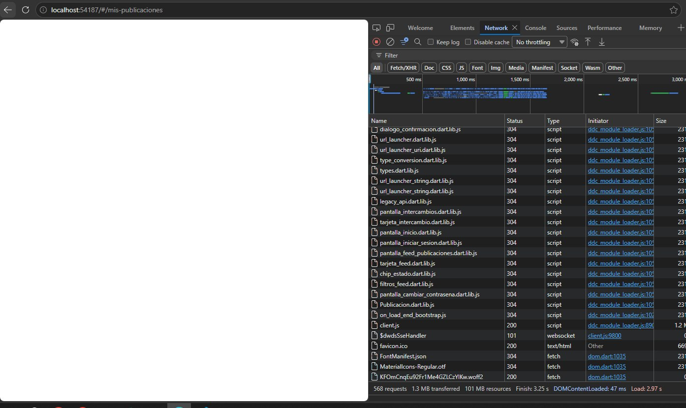
- **Después** (`HEAD`): `trueque-u/app/lib/servicios/cliente_api.dart:L66-L70`, `L93-L109`.
  - Captura: 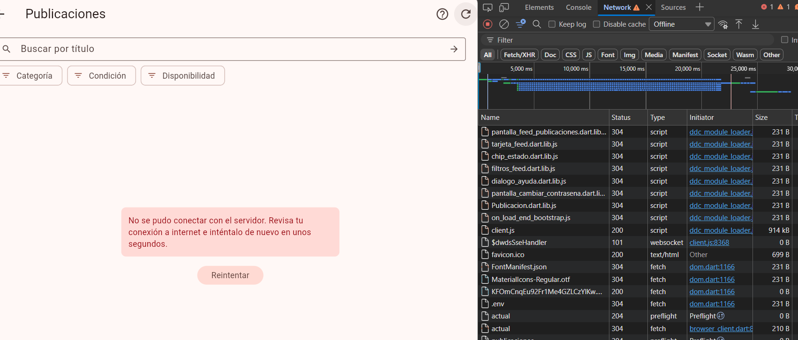
- **Ya cumplía:** `trueque-u/app/lib/widgets/error_con_reintento.dart:L5-L36` (mensaje + «Reintentar») y los mensajes del backend en `trueque-u/backend/src/controllers/reservas.controlador.js:L33-L59`.
- **Diff:**

```diff
diff --git a/trueque-u/app/lib/servicios/cliente_api.dart b/trueque-u/app/lib/servicios/cliente_api.dart
--- a/trueque-u/app/lib/servicios/cliente_api.dart
+++ b/trueque-u/app/lib/servicios/cliente_api.dart
@@ -67,3 +67,3 @@ class ClienteApi {
       throw ExcepcionApi(
-        'No se pudo conectar con el servidor. ¿Está encendido el backend?',
+        'No se pudo conectar con el servidor. Revisa tu conexión a internet e inténtalo de nuevo en unos segundos.',
       );
@@ -100,3 +100,3 @@ class ClienteApi {
       408 => 'La solicitud tardó demasiado en enviarse. Intenta de nuevo.',
-      409 => 'La acción choca con el estado actual. Actualiza e intenta de nuevo.',
+      409 => 'Esta publicación cambió mientras la mirabas. Actualiza la lista e inténtalo de nuevo.',
       500 => 'El servidor tuvo un problema interno. Intenta más tarde.',
@@ -105,5 +105,6 @@ class ClienteApi {
       504 => 'El servidor tardó demasiado en responder. Intenta de nuevo en unos segundos.',
-      _ => 'Ocurrió un error inesperado.',
+      _ => 'Ocurrió un error inesperado. Inténtalo de nuevo.',
     };
-    return 'Error $codigo: $explicacion';
+    // El código HTTP queda solo en el registro de depuración, no en pantalla
+    return explicacion;
   }
```

### H10 — Ayuda y documentación
- **Estado:** Corregida · **Severidad:** 2 (Menor) · **Sub-issue:** #16 · **Commit:** `a769104`
- **Pantalla / flujo:** Feed de publicaciones.
- **Explicación.** La app no explicaba el flujo (reservar → coordinar → entregar → completar) ni qué significa cada estado; la persona nueva tenía que deducirlo. Se agregó un icono «?» en la barra del feed que abre un diálogo corto «¿Cómo funciona?», enfocado en completar la tarea. Ya existían ayudas puntuales: tooltips en los iconos (`trueque-u/app/lib/widgets/tarjeta_mi_publicacion.dart:L94-L96`) y estados vacíos con la acción siguiente.
- **Antes** (`34f3d53`): `trueque-u/app/lib/pantallas/pantalla_feed_publicaciones.dart:L349-L364` (barra sin ayuda).
  - Captura: 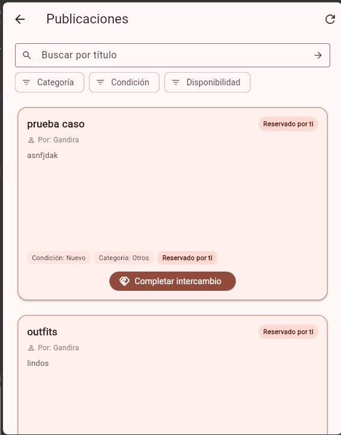
- **Después** (`HEAD`): `trueque-u/app/lib/pantallas/pantalla_feed_publicaciones.dart:L397-L407` · `trueque-u/app/lib/widgets/dialogo_ayuda.dart:L1-L78`.
  - Capturas: 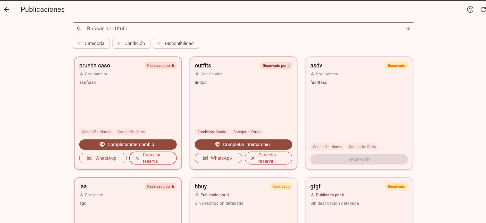 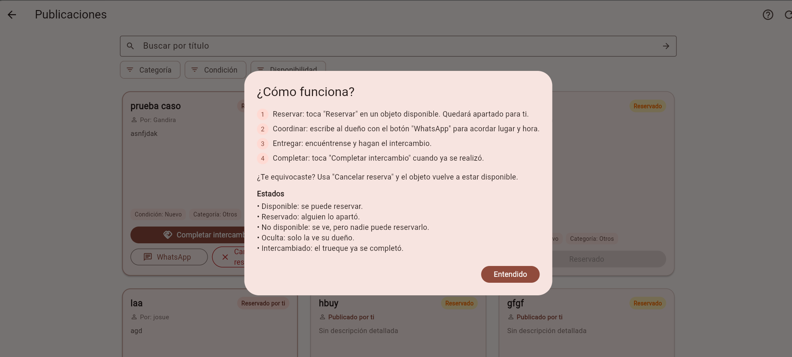
- **Diff:**

```diff
diff --git a/trueque-u/app/lib/pantallas/pantalla_feed_publicaciones.dart b/trueque-u/app/lib/pantallas/pantalla_feed_publicaciones.dart
--- a/trueque-u/app/lib/pantallas/pantalla_feed_publicaciones.dart
+++ b/trueque-u/app/lib/pantallas/pantalla_feed_publicaciones.dart
@@ -7,2 +7,3 @@ import '../servicios/cliente_api.dart';
 import '../utilidades/whatsapp.dart';
+import '../widgets/dialogo_ayuda.dart';
 import '../widgets/dialogo_confirmacion.dart';
@@ -396,2 +397,8 @@ class _PantallaFeedPublicacionesState extends State<PantallaFeedPublicaciones> {
         actions: [
+          // H10: ayuda contextual, siempre a un toque
+          IconButton(
+            icon: const Icon(Icons.help_outline),
+            tooltip: 'Ayuda: ¿cómo funciona?',
+            onPressed: () => mostrarAyudaTrueque(context),
+          ),
           IconButton(
diff --git a/trueque-u/app/lib/widgets/dialogo_ayuda.dart b/trueque-u/app/lib/widgets/dialogo_ayuda.dart
new file mode 100644
--- /dev/null
+++ b/trueque-u/app/lib/widgets/dialogo_ayuda.dart
@@ -0,0 +1,78 @@
+import 'package:flutter/material.dart';
+
+/// Ayuda corta y contextual: cómo se reserva y se entrega un objeto en Trueque U.
+Future<void> mostrarAyudaTrueque(BuildContext context) {
+  return showDialog<void>(
+    context: context,
+    builder: (ctx) => AlertDialog(
+      title: const Text('¿Cómo funciona?'),
+      content: SingleChildScrollView(
+        child: Column(
+          mainAxisSize: MainAxisSize.min,
+          crossAxisAlignment: CrossAxisAlignment.start,
+          children: const [
+            _Paso(
+              numero: '1',
+              texto: 'Reservar: toca "Reservar" en un objeto disponible. Quedará apartado para ti.',
+            ),
+            _Paso(
+              numero: '2',
+              texto: 'Coordinar: escribe al dueño con el botón "WhatsApp" para acordar lugar y hora.',
+            ),
+            _Paso(
+              numero: '3',
+              texto: 'Entregar: encuéntrense y hagan el intercambio.',
+            ),
+            _Paso(
+              numero: '4',
+              texto: 'Completar: toca "Completar intercambio" cuando ya se realizó.',
+            ),
+            SizedBox(height: 8),
+            Text('¿Te equivocaste? Usa "Cancelar reserva" y el objeto vuelve a estar disponible.'),
+            SizedBox(height: 12),
+            Text('Estados', style: TextStyle(fontWeight: FontWeight.bold)),
+            SizedBox(height: 4),
+            Text(
+              '• Disponible: se puede reservar.\n'
+              '• Reservado: alguien lo apartó.\n'
+              '• No disponible: se ve, pero nadie puede reservarlo.\n'
+              '• Oculta: solo la ve su dueño.\n'
+              '• Intercambiado: el trueque ya se completó.',
+            ),
+          ],
+        ),
+      ),
+      actions: [
+        FilledButton(
+          onPressed: () => Navigator.of(ctx).pop(),
+          child: const Text('Entendido'),
+        ),
+      ],
+    ),
+  );
+}
+
+class _Paso extends StatelessWidget {
+  const _Paso({required this.numero, required this.texto});
+
+  final String numero;
+  final String texto;
+
+  @override
+  Widget build(BuildContext context) {
+    return Padding(
+      padding: const EdgeInsets.only(bottom: 6),
+      child: Row(
+        crossAxisAlignment: CrossAxisAlignment.start,
+        children: [
+          CircleAvatar(
+            radius: 11,
+            child: Text(numero, style: const TextStyle(fontSize: 12)),
+          ),
+          const SizedBox(width: 8),
+          Expanded(child: Text(texto)),
+        ],
+      ),
+    );
+  }
+}
```

---

## 3. Leyes de Fitts y Hick aplicadas

| Ley | Dónde se aplicó | Referencia |
|---|---|---|
| **Fitts** | «Reservar» ocupa todo el ancho de la tarjeta (cumple). Iconos de editar/eliminar recuperaron el área táctil de 48 px y se separó el destructivo (#13). «WhatsApp» y «Cancelar reserva» son botones anchos junto a la acción principal (#8, #9). | `trueque-u/app/lib/widgets/tarjeta_feed.dart:L196-L199`, `trueque-u/app/lib/widgets/tarjeta_mi_publicacion.dart:L140-L147`, `trueque-u/app/lib/widgets/tarjeta_feed.dart:L243-L268` |
| **Hick** | Cada tarjeta muestra como máximo 3 acciones (completar, WhatsApp, cancelar); los filtros se agrupan en 3 menús; la ayuda resume el flujo en 4 pasos. El perfil con 6 acciones queda como observación. | `trueque-u/app/lib/widgets/tarjeta_feed.dart:L230-L280`, `trueque-u/app/lib/widgets/filtros_feed.dart:L81-L89`, `trueque-u/app/lib/pantallas/pantalla_perfil.dart:L27-L56` |

---

## 4. Guía para tomar las capturas (manual)

Las capturas se guardan en `docs/evidencias/` con **exactamente** estos nombres (el documento ya las enlaza). Marca cada casilla al terminar. Las 3 capturas del 13/oct ya están renombradas y cubren H3, H5, H7 y H8 «antes».

### 4.1 Preparación

1. **Dos usuarios** (usa dos navegadores o una ventana de incógnito): **A = dueño** (con teléfono de 8 dígitos) y **B = quien reserva**.
2. Con **A**: crea 2 publicaciones («Calculadora» y «Libro de álgebra»). Deja ambas *disponibles*.
3. **Versión ANTES** (para las capturas «antes»): en la carpeta del repositorio
   ```powershell
   git switch --detach 34f3d53
   ```
   Levanta el backend y la app como siempre (`npm start` en `trueque-u/backend`, `flutter run -d chrome` en `trueque-u/app`).
4. **Versión DESPUÉS**: vuelve a la rama y reinicia backend y app (**el backend debe ser el local con los cambios**; si usas el de Render, H7 no mostrará el botón hasta desplegarlo):
   ```powershell
   git switch main
   ```
5. Tip de capturas: pantalla completa del navegador a 100 % de zoom; en H1 y H9 usa las herramientas de desarrollador (F12).

### 4.2 Capturas por heurística

| ☐ | Archivo | Versión | Cómo llegar y qué debe verse |
|:-:|---|:-:|---|
| ☑ | `H5_antes_01_feed_boton_reservar.png` | ya existe | Feed con el botón «Reservar». |
| ☑ | `H5_antes_02_reserva_inmediata_sin_dialogo.png` | ya existe | Spinner en la tarjeta justo tras tocar «Reservar», sin diálogo (también evidencia H1 en el feed). |
| ☑ | `H3-H7_antes_01_reservado_sin_cancelar_ni_contacto.png` | ya existe | Tarjetas «Reservado por ti» con solo «Completar intercambio»; sin «Cancelar» ni contacto; chip y etiqueta repetidos (H8). |
| ☐ | `H1_antes_01_mis_publicaciones_sin_progreso.png` | ANTES | **A** → Mis publicaciones. F12 → Network → *Slow 3G*. Toca el menú ⋮ → «Ocultar publicación» y captura mientras responde: la tarjeta **no** muestra progreso. |
| ☐ | `H1_despues_01_mis_publicaciones_con_progreso.png` | DESPUÉS | Mismo paso: se ve la **barra de progreso** arriba de la tarjeta y los iconos deshabilitados. |
| ☐ | `H2_antes_01_ver_en_mis_pubs.png` | ANTES | **A** → Feed: en su propia publicación el botón dice «Tu publicación (Ver en mis pubs)». |
| ☐ | `H2_antes_02_aviso_valor_interno.png` | ANTES | **A** → Mis publicaciones → ⋮ → «Marcar como No disponible»: el aviso dice `cambiada a "no disponible"`. |
| ☐ | `H2_despues_01_ver_en_mis_publicaciones.png` | DESPUÉS | Mismo lugar: «Ver en mis publicaciones». |
| ☐ | `H2_despues_02_aviso_legible.png` | DESPUÉS | Mismo paso: «Tu publicación ahora está no disponible (nadie puede reservarla)». |
| ☐ | `H3_despues_01_boton_cancelar_reserva.png` | DESPUÉS | **B** reserva la «Calculadora»: la tarjeta muestra «Completar intercambio», «WhatsApp» y «Cancelar reserva». |
| ☐ | `H3_despues_02_dialogo_cancelar_reserva.png` | DESPUÉS | **B** toca «Cancelar reserva»: diálogo con «Mantener reserva» / «Sí, cancelar reserva». |
| ☐ | `H4_antes_01_completar_gris_pero_activo.png` | ANTES | **A** → Mis publicaciones con una publicación *disponible*: «Completar intercambio» en gris. Tócalo: aparece el aviso (se ve gris pero responde). |
| ☐ | `H4_despues_01_completar_deshabilitado_con_tooltip.png` | DESPUÉS | Mismo lugar: botón deshabilitado y tooltip «Disponible cuando alguien reserve la publicación» (pasa el mouse encima). |
| ☐ | `H5_despues_01_dialogo_confirmar_reserva.png` | DESPUÉS | **B** toca «Reservar» en «Libro de álgebra»: aparece el diálogo «¿Quieres reservar…?». |
| ☐ | `H5_antes_03_iconos_pequenos.png` | ANTES | **A** → Mis publicaciones: iconos de editar, ⋮ y eliminar pequeños y juntos (F12 → inspeccionar un icono muestra ~20 px). |
| ☐ | `H5_despues_03_iconos_area_estandar.png` | DESPUÉS | Mismo lugar: iconos de 48 px con «Eliminar» separado (F12 → ~48 px). |
| ☐ | `H6_cumple_01_filtros_activos.png` | DESPUÉS | Feed → «Categoría» → «Libros»: aparece el chip «Categoría: Libros» con su «X» y «Quitar todos». |
| ☐ | `H6_cumple_02_dialogo_completar_con_titulo.png` | DESPUÉS | **B** (con reserva) toca «Completar intercambio»: el diálogo nombra el objeto. **Cancela** para no cerrar el intercambio. |
| ☐ | `H7_despues_01_boton_whatsapp_quien_reservo.png` | DESPUÉS | **B** con su reserva activa: botón «WhatsApp» en la tarjeta (el dueño A debe tener teléfono). |
| ☐ | `H7_despues_02_aviso_siguiente_paso.png` | DESPUÉS | Justo después de confirmar la reserva: aviso «Reservaste "…". Escríbele al dueño por WhatsApp…». |
| ☐ | `H8_despues_01_tarjeta_sin_duplicados.png` | DESPUÉS | Tarjeta reservada por **B**: solo el chip superior «Reservado por ti»; y en una reservada por otra persona, solo «Reservado». |
| ☐ | `H9_antes_01_error_con_codigo_y_jerga.png` | ANTES | Detén el backend (o desconecta internet) y toca «Actualizar»: «No se pudo conectar… ¿Está encendido el backend?». |
| ☐ | `H9_despues_01_error_en_lenguaje_simple.png` | DESPUÉS | Mismo paso: «Revisa tu conexión a internet e inténtalo de nuevo…» con «Reintentar». |
| ☐ | `H10_antes_01_feed_sin_ayuda.png` | ANTES | Feed: la barra superior solo tiene el botón de actualizar. |
| ☐ | `H10_despues_01_icono_ayuda.png` | DESPUÉS | Feed: icono «?» en la barra. |
| ☐ | `H10_despues_02_dialogo_ayuda.png` | DESPUÉS | Toca «?»: diálogo «¿Cómo funciona?». |

### 4.3 Flujo completo de entrega (para una captura de contexto, opcional)

**A** crea → **B** reserva (confirma) → **B** pulsa «WhatsApp» → **A** ve en Mis publicaciones «Reservado por: B» + WhatsApp → cualquiera completa (confirma) → ambos ven el trueque en «Intercambios completados».

---

## 5. Límites de esta evaluación (transparencia)

- **Dart no se compiló ni se ejecutó** en el entorno donde se hicieron las correcciones (no hay Flutter allí). Antes de entregar: `flutter analyze` y recorrer el flujo de la sección 4. La parte de backend sí se probó: `npx jest` → 9 pruebas, 0 fallos (2 nuevas para H7).
- Los **sub-issues #7–#16 no pudieron crearse automáticamente** (GitHub rechazó la escritura desde la sesión). Su texto está en `docs/sub-issues.md`; los commits ya citan esos números. Crea los issues **en ese orden y antes de hacer `git push`** para que queden vinculados.
- «Recibí conforme / Entregué conforme» (issue #2 del backlog) aún no están implementados, por eso la evaluación llega hasta «Completar intercambio».
- Esta evaluación cubre solo el flujo de trueque hasta reserva y entrega. Registro, recuperar contraseña y cambiar contraseña quedan fuera de alcance (no se evaluaron en profundidad).
